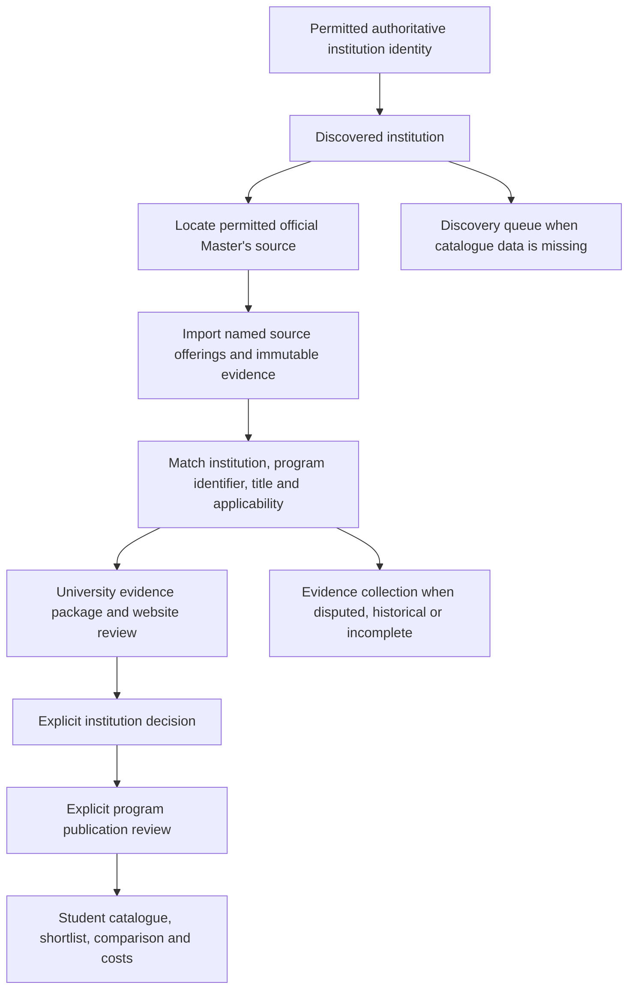

# Master's evidence and review implementation — 2026-10-21

This report distinguishes the verified implementation from source-data coverage.
The approved development catalogue reset is complete. No development reimport,
fact verification, institution approval, publication or scheduling was performed.

## Architecture and decision boundaries

The application remains FastAPI/SQLAlchemy/PostgreSQL with Alembic, the existing
in-process ingestion worker, and the existing Vue frontend. It reuses institution
identity review, institution approval, fact versions/review and program publication.

`review_readiness.py` derives progress and eligibility from evidence; it does not
rewrite reviewer decisions. An institution without imported named Master's
offerings stays in discovery. A coherent offering needs accepted source identity,
the source's institution association, a matching title from the identity document,
permitted successful retrieval and supporting row evidence. Rejected/conflicting
title facts, failed retrieval, unrelated documents, expired offerings and historical
campaigns cannot establish readiness. Evidence older than 180 days requires refresh.
Unspecified academic periods remain visible limitations.

The university screen groups official name/country, authoritative identifiers,
website verification, identity evidence, catalogue documents, actual offerings,
qualification/pathway/stage/location information, coverage, applicability, missing
facts, disputed links and immutable review history. Discovery, evidence collection
and ready categories are distinct, and category filtering occurs before pagination.
Technical fact review remains available underneath the main evidence package.

Institution approval alone never publishes a program. Student-facing catalogue,
details, saved records, comparison, recommendations, eligibility and costs enforce
institution approval and program publication. The isolated browser journey proved
that approving Almería leaves all five real offerings hidden from students.

## Root-cause corrections

### Phase outcomes

| Phase | Verified outcome |
| --- | --- |
| Understand and reproduce | Development counts/schema independently checked; ten readiness regressions reproduced on previous code; real HD/IC ownership failure reproduced live. |
| Archive and recover | Independent restore, injected rollback, idempotence and provenance passed before exact development approval. Approved reset completed with 1,479 archive rows. |
| Master's review | Existing review models extended with coherent package derivation, discovery categories and grouped programme evidence; browser decisions passed. |
| Connectors and identity | Bounded ROR/IPEDS/UAL/Mon Master/DUO checks and repeat imports passed across recorded runs; genuine keys retained, competing owners rejected, unsupported relationships held. |
| Facts and links | Exact observed URL evidence and distinct link roles enforced; structured values project only after explicit review. Missing facts remain unknown. |
| Refresh | Committed metrics, worker sessions, retry options, reversion/conflict detection and schedule guards tested; development scheduling remains off. |
| Student integration | Visibility, saved/compare/profile/eligibility/shortlist/finance exercised with isolated accounts; unpublished real records stayed hidden. |
| Deploy and recheck | Application deployed, exact migration/reset verified, schema/protected hashes checked, actual empty Discover rendered in Chrome. |

Source coverage remains limited as described below; successful workflow
implementation does not establish missing course facts.

| Area | Correction |
| --- | --- |
| Institution readiness | Identity-only institutions no longer qualify; coherent named Master's evidence and the exact reviewed website are required. |
| Identity matching | UAI and RIO identifiers participate in authoritative identity evaluation. Weak website matches still require a reviewer. Different canonical identifier owners remain conflicts. |
| Cross-source identifier ownership | HD and IC can corroborate one university without violating accepted-identifier uniqueness. The first accepted owner/source survives; subsequent source claims become versioned evidence. Failed or unsupported corroboration cannot create a valid link. |
| URLs | Course pages, government program records, general catalogues, datasets, APIs, identifier resolvers, candidates and missing links have separate roles. A verified flag cannot turn a catalogue into a course page. |
| Exact link evidence | A reviewed course URL requires a matching title, university domain and either the retrieved page itself or that exact link in the source excerpt. Government record links also require matching accepted source identifiers. |
| Worker execution | Queued workers use their own valid session rather than calling `db.get` when no session was supplied. |
| Metrics and retry | Counters become committed metrics only after successful batch commits; partial failures retain successful work; retries preserve bounded options and attempt history. |
| Refresh conflicts | Replaying the same changed verified fact does not append duplicate conflicts. Reviewer-approved values/decisions are not silently overwritten. Document reversion A → B → A is a real content change. |
| Structured facts | Explicit human fact approval projects supported website/title/course URL, fees, admissions rules and intake dates into existing relational tables. Incomplete prose remains evidence only. Validation catches invalid amounts, categories, operators, dates and flags before database writes. |
| Eligibility | Real programs require reviewed requirement evidence; mandatory unknown/conflicting evidence remains unknown. Stored OR groups work; optional unmet criteria do not become mandatory failures. |
| Costs | Alternative academic years/categories are not added together. Unknown duration/period, conflicting/stale fee evidence and mixed currencies cannot produce asserted full-degree totals. Quality badges follow current fact conflicts. Missing components remain null and are explicitly excluded, never counted as zero. |
| Runtime | Readiness returns 503 for missing/incompatible schema; optional additive schema fields remain backward compatible. Invalid incoming request IDs cannot crash audit writes. |

## Catalogue archival and reset

See [the operator runbook](CATALOGUE_ARCHIVE_RESET_RUNBOOK.md) for exact scope,
backup hashes, safeguards and the approved operation. Migration `85b2e4a6c910` adds
two immutable archive tables and archive references on retained review rows.

The complete pre-reset backup was restored independently before planning. The
marked recovery rehearsal verified full content hashes, schema consistency,
injected-failure transaction rollback, exact deletion counts, protected row hashes,
idempotent replay and historical decision interpretation. The original restored
catalogue remains in the separate recoverability database.

After explicit approval of the final development operation, the application was
deployed first; the exact new migration applied from `7a3d9f2c1e60`; the plan was
compared again; and reset operation `a0839f88-9fd0-4a57-9499-d86f6d4540b7` committed.

| Development state | Verified result |
| --- | --- |
| Alembic | `85b2e4a6c910`; no model drift |
| Active universities / programs | **0 / 0** |
| Independent archive records | **1,479**, every payload hash checked |
| Users / profiles | **2 / 1**, original protected hashes retained |
| Reference facts / versions / evidence | **30 / 30 / 30** |
| Institution reviews | **13 retained and archived**, zero active pending reviews |
| Source identity reviews / immutable events | **1 / 1 retained**, original UAL association available in archive |
| Audits / jobs / source documents | **3 / 13 / 6 retained** |
| Whole protected tables / scoped reference sets | **34 / 5** independently compared after reset |
| Unvalidated foreign keys / unarchived null university reviews | **0 / 0** |
| Development runtime | `uni_shortlist_app`; superuser/create DB/create role/bypass RLS all false |
| PostgreSQL volume | Original `uni-grp-prj_pgdata` preserved |
| Scheduling | Disabled |

The previous dependency note was incorrect about two outcome rows: both have null
program/university associations and are subject/country references. They and their
two facts survive. The reset removed 385 catalogue facts, retaining 30 references.

Pre-reset backup: `.db-backups/uni_shortlist_20261021T132903Z.dump`, SHA-256
`6a7228f2ffcc8ad74cde90a6c6ce97b93d521cfc46610c8474122f6c9a7b6b12`.
Additional post-reset backup: `.db-backups/uni_shortlist_20261021T144741Z.dump`,
SHA-256 `50b63f934fcbb872d04ece0ab2cf7beef29f672b8de634466b9085881e5f39ac`.
Both are private, complete database archives outside the PostgreSQL volume.

## Source connections, evidence coverage and reuse

The following are adapter capabilities and bounded isolated results, not claims
that development has been repopulated.

| Source | Access / reuse | Verified contribution and limits |
| --- | --- | --- |
| ROR | Official API, CC0 | Exact Almería institution query, authoritative identity and source website evidence. It supplies no named Master's catalogue. |
| IPEDS HD2024 | Official NCES ZIP + dictionary; federal public data | Bounded 25 institutions and successful repeat imports. Institution information only. No inferred Master's courses. |
| IPEDS IC2023 | Official NCES historical ZIP + dictionary; federal public data | Historical institutional charges, explicitly scoped to reporting year. Missing values remain absent; they are not program tuition. HD2024/IC2023 coexist with one accepted canonical identifier owner. |
| UAL official Master's JSON | [Official dataset reuse record](https://datos.gob.es/es/catalogo/u04800001-titulos-universitarios), CC BY attribution | Five genuine offerings imported after explicit isolated source identity review. The 64-row feed had 35 supported single-institution, non-double rows. Source title, plan ID, discipline and explicit delivery values are retained. No individual course URLs, tuition, requirements, duration or deadlines are supplied. Raw display flags remain evidence; no undocumented meaning is asserted. |
| French Mon Master | [Official catalogue](https://data.enseignementsup-recherche.gouv.fr/explore/dataset/fr-esr-mon_master/), Licence Ouverte | Five offerings imported/replayed with stable offering keys and UAI linkage. Source-qualified disciplines, mention/track IDs and location/campaign survive. The feed is a historical 2025 campaign (metadata also describes 2024/2025); rechecking it does not make it a current catalogue. It cannot establish current readiness. No individual course URL is invented. |
| DUO/RIO | Official DUO Open Data API, CC BY 4.0 | Five current/future source offerings imported/replayed. Source UUID/provider ID, dates, reported load/location, teaching language and explicit study mode are retained. Expired/incomplete rows and unsupported joint/partner rows are held/skipped with metrics. `WEBSITE` is a candidate institution pointer. No guessed course URL or ECTS unit. |
| Studyinfo/Konfo | Official external API implementation located | API/software availability does not establish a reusable dataset licence. No connector enabled without the data-access/reuse basis. |
| CRICOS | Official licensed/dataset route evaluated | Dataset endpoint unavailable during bounded checks; access/reuse licence not established for ingestion. No connector or scraping enabled. |
| RUCT/QEDU | Official route evaluated | No verified permitted machine-readable connection established in this session. No scraping enabled. |

Before reset, 70 real programs were stored: 35 UAL and 35 French offerings.
None had reviewer-verified individual university URLs or relational fees,
requirements or intakes. Ten real institutions had no associated named programs.
That historical catalogue is now archived; **development has no active offerings**.
No claim of current international program coverage is made.

Program identity remains offering scoped. Same-title distinct authoritative keys
are preserved. Source-qualified qualification/mention/pathway IDs and unknown
M1/M2 stages are explicit. Awarding/consortium roles are not inferred from an
institution association; unsupported joint rows are held rather than flattened
into false single-university records. Full joint-award graph ingestion remains
outside the supported connector scope.

## Freshness and operational control

Existing source publication/academic-period/check/change timestamps and immutable
retrieval history are reused. Content hashes version documents; unchanged checks
and content changes differ. Historical applicability remains historical after a
successful retrieval. Missing publication dates stay unknown.

Global `ENABLE_SCHEDULER` remains false. A stored refresh interval alone cannot
authorize scheduling: source metadata must also contain approved schedule state,
an approval reference and a positive bounded record limit. Adapters requiring
explicit operator limits remain manual. Current tests exercise queue execution,
partial recovery, committed counters, retry options, conflict replay and
idempotency. No development source schedule was enabled or changed.

## Runtime and browser verification

Final guarded backend suite: **327 passed, 7 skipped** (76.60 seconds); the seven
skips are opt-in live cases. Frontend typecheck, ESLint and production build passed;
Vitest **36 passed**. The latest combined live run was **6 passed, 1 failed** due
to temporary NCES DNS failure after three bounded retries. The standalone NCES
directory/idempotency rerun was **2 passed**, requiring both imports to succeed.
Each of the seven live cases therefore passed in the recorded runs; the transient
failed combined run is retained rather than described as a single all-green run.
Tests found and corrected a real HD/IC identifier uniqueness failure, unsupported
URL evidence, worker session handling, misleading fee quality and missing-cost
explanations. Tests never targeted development for mutations.

Authenticated isolated browser accounts have real admin/reviewer and student roles.
The Chrome journeys exercised:

1. Identity-only Almería in discovery, blocked institution approval, named source
   candidates and an explicit source identity link with immutable event.
2. Five official named UAL offerings with source evidence and explicit missing
   course links; a needs-evidence institution decision; technical website fact
   verification; then institution approval with both events preserved.
3. Program publication remaining blocked by missing individual links, and public
   catalogue staying at nine labelled demo fixtures after institution approval.
4. Source registry, ingestion jobs, audit and admin overview.
5. Student login, Discover, detail, Save, Compare, profile, explicit eligibility,
   recommendation/shortlist run, finance and 403 on admin review access.

The completed journeys contain 31 assertions (identity 5, review 14, student 12).
Authenticated archive API reads also verify admin access, student/anonymous denial
and original archived university associations. No JavaScript exception occurred.
Initial harness text
and asynchronous rendering assertions were corrected and rerun. Programme
candidates in source identity review now open by default. The student visual
design was preserved.

Actual development verification after reset: API :8000, NGINX :8080 and Vite :5173
return readiness 200, catalogue 200 with zero programs, and all 13 country
references. Headless Chrome renders the empty Discover state without application
errors. Archive hashes, original source identity review context and preserved
reference contents were checked through the deployed least-privilege runtime.

The reproducible guarded browser tools are
`scripts/prepare-masters-browser.py` and `scripts/verify-masters-browser.mjs`.
They require a marked isolated database, explicit test mode, loopback port 8082
and private ephemeral credentials. Fixture preparation deliberately resets only
the marked test database. Run identity first, perform the bounded UAL reimport,
then run review and student phases. They are opt-in integration tools, not a
development seed or a way to approve real development data.

## Remaining boundaries

- No pending approval remains for the completed archive/reset.
- Development scheduling still requires a separate operational decision.
- New data sources need documented access/reuse permission before integration.
- Existing program feeds do not establish individual course links, current French
  availability, or tuition/admissions/intake facts. Those facts remain unknown.
- The evidence workflow is implemented and demonstrated; a populated, reviewed,
  current international student catalogue has not been produced by this reset.
- No Git command, PostgreSQL volume deletion, automatic development approval,
  automatic publication or prohibited scraping was performed.

## Suggested manual commit boundaries

No Git operation was run. Suggested review/commit groups:

1. **Archive and recovery:** archive models/service/migration, identity model
   additions, `app/db/catalogue_reset.py`, archive endpoints/UI, reset tests,
   recovery script and archive runbook.
2. **Master's evidence and review:** readiness service, program link evidence and
   URL roles, grouped institution/identity/program review backend and frontend,
   review tests and API/schema contract additions.
3. **Source ingestion and refresh:** adapter/normalization/persistence changes,
   worker/metrics/retry/cache/scheduler fixes and ingestion/live/refresh tests.
4. **Reviewed facts and student integration:** explicit relational projection,
   eligibility/cost/catalogue/library/recommendation corrections, readiness and
   request-ID handling, student detail source links and regression tests.
5. **Verification and documentation:** guarded browser scripts, final status and
   this report. Keep private backups, credentials and browser profiles out of commits.

The [exact changed-file inventory](MASTERS_CHANGED_FILES.md) covers this
implementation checkpoint. New files include
`review_readiness.py`, `fact_projection.py`, `archive.py`, `catalogue_reset.py`,
`models/archive.py`, migration `85b2e4a6c910`, four new regression test modules,
and the two browser tools. Existing changes span ingestion adapters/pipeline,
admin/catalogue/eligibility/cost services, admin Vue views and typed API contracts.
