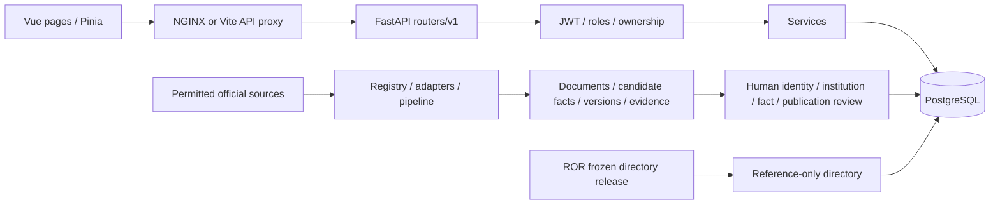

# UniShortlist — complete technical project handover

**Recovery checkpoint: 2026-10-22, 08:20 UTC / 13:50 IST.** This document records existing work. Only Markdown was edited for this checkpoint. PostgreSQL inspections used read-only transactions; existing logs were read, not new test runs. No ingestion, migration, deployment, approval, publication or source crawl occurred.

## 1. Purpose, evidence and reading order

UniShortlist is an evidence-first Master's discovery, institution/programme review and student shortlisting application. A global research-organization reference directory is an additional discovery input. Directory membership, canonical identity, institution approval, verified facts and programme publication are separate controls.

Read first:

1. [Interrupted work recovery](UNISHORTLIST_INTERRUPTED_WORK_RECOVERY.md): exact stopping point, manifests, backup, plan and safe next commands.
2. This handover: architecture, history, current deployment, schema, pilot, verification and unfinished inventory.
3. [Global programme execution plan](UNISHORTLIST_GLOBAL_PROGRAMME_EXECUTION_PLAN.md): client requirements, milestones and ordered backlogs.
4. [Source coverage matrix](UNISHORTLIST_SOURCE_COVERAGE_MATRIX.md): rights, real counts, exclusions and country gaps.
5. [Submission summary](UNISHORTLIST_DEADLINE_SUBMISSION_SUMMARY.md): shareable factual summary.
6. [Historical project status](UNIVERSITY_SHORTLISTING_PROJECT_STATUS.md), [API contract](API_Contract.md), [database specification](Database_Schema.md), [UI flows](UI_Flow_and_Routes.md), [earlier Master's report](MASTERS_IMPLEMENTATION_REPORT.md), [earlier changed-file list](MASTERS_CHANGED_FILES.md), [archive runbook](CATALOGUE_ARCHIVE_RESET_RUNBOOK.md).

No `AGENTS.md` was found in the repository inspection. `docs/rules.md` applies, except explicit user instructions override its suggestions to use Git, avoid separate handovers or continue implementation. **No Git commands are permitted.** The user specifically requested these six documents and paused code work.

### Evidence labels used throughout

| Label | Meaning |
| --- | --- |
| IMPLEMENTED IN CODE | Inspected repository contains the relevant implementation. |
| TESTED | A corresponding passing execution result exists; identify whether historical or current. |
| DEPLOYED | Running service actually contains/exposes it; a source file alone is insufficient. |
| DATA POPULATED | Records actually persisted in the named database. Recovery data is not development data. |
| END-TO-END VERIFIED | A genuine workflow completed. API-only checks do not establish a new browser journey. |

Evidence used: real source files/configuration; read-only development and isolated recovery SQL; current public GET responses; running API settings/file fingerprints; immutable source snapshot manifests; operator plans; saved `/tmp/uni-program-*` execution logs; historical project reports. No hidden previous transcript or complete shell history is assumed. Full teammate master-prompt text and a Git working-tree diff are unavailable; see the execution plan and recovery document for explicit unknowns.

## 2. Current actual state

### 2.1 Development database and public API — independently checked now

| Item | Verified current value |
| --- | --- |
| Database / schema | PostgreSQL `uni_shortlist`; Alembic `9c24a7e6d180` |
| ROR reference directory | **30,328** rows, **223** country/territory codes |
| Canonical universities | **1**, Universidad de Almería, approved |
| Real Master's programmes | **5**, Spain / `ual_masters` only |
| Accepted programme identities | **5** |
| Verified individual official-page facts | **5** |
| Published / candidate programmes | **1 / 4** |
| Facts / versions / evidence | **66 / 67 / 67** |
| Source documents / jobs / audit events | **14 / 23 / 15** |
| Independent archived catalogue records | **1,479** |
| Users / profiles | **2 / 1** |
| Active source-identity review decisions | **2 approved**, distinct from institution approval |
| Archived source-identity reviews | **1**, excluded from active matching decisions |
| Archived institution reviews | **13**, detached with archive operation; one active approved institution review |
| Scheduler | **False** in running API settings |
| Runtime database role | `uni_shortlist_app` |
| Readiness | `GET /api/v1/health/ready` → ready, database ok, schema initialized |
| Student Discover | `GET /api/v1/programs` → **one** published programme |

The published programme's tuition, duration, teaching language, admissions, intake and deadline remain unavailable. Its source page is verified; academic completeness is limited (0/7 verified academic groups). A reviewed description is publicly returned with attribution and evidence metadata. Legacy `data_quality.status` remains `unavailable` for compatibility; this is not an identity-verification failure.

### 2.2 Global directory baseline — historical release audit, current counts reconfirmed

ROR **v2.15**, published 2026-10-20, concept DOI <https://doi.org/10.5281/zenodo.6347574>, release DOI <https://zenodo.org/records/23500708>. Official bulk ZIP, not full REST pagination:

- 146,716 source organizations examined; 30,328 active education references selected; 116,388 excluded.
- 223 country/territory codes; zero malformed rows, duplicate/conflicting ROR IDs or import failures.
- Five archive-identity reconciliation flags, one existing active ROR match (UAL), 913 missing website candidates.
- ZIP SHA256 `7a7bf58d5ac18436ed98daf5da906913761d54869edf86d405e51966609dd133`; published MD5 `5522990688eb1b94811a8145e131b41e` checked in directory delivery.
- CC0 identity data, retained GeoNames CC BY 4.0 attribution; release metadata includes publication/retrieval/validation and checksum history.
- Development directory job `c87b1464-3965-4cb6-a9e1-9fe59d3fc014` succeeded after exact user authorization. Full isolated replay produced zero creates / 30,328 unchanged.

The selection is ROR's active `education` classification. It is **not** an accreditation census, proof of Master's provision, 30,328 approved universities or 30,328 programmes. Directory links to an existing canonical institution do not convert reference rows into approval records.

### 2.3 Isolated programme rehearsal — current counts independently checked

Database `uni_shortlist_recovery`, project `uni-shortlist-program-recovery`: **150 canonical institutions**, one approved and 149 pending; **9,349 Master's offerings** = original ES5 + NL1,501 + FR7,843. Only original one is published; 9,348 candidates; original five verified pages; 1,479 archived rows unchanged. Totals: 80,713 facts / 80,717 versions / 81,599 evidence / 119 source documents.

Of the proposed additions, French 7,843 are explicitly historical 2025; Dutch 1,484 are unexpired registry offerings and 17 future. None of these labels establish open admissions. All 9,349 lack relational tuition/admissions/deadline/duration. These successful isolated records have **not** been imported into development.

### 2.4 Running services and deployment boundary

Current main Compose services: `db` healthy (host 5433), `api` running (8000), `web` Vite running (5173), `nginx` running (8080), and an isolated `db-test`. Separate older test/recovery projects also remain running; do not confuse their names/data with development.

Main API is an image build with **no source bind mount**. Read-only inspection confirmed `program_import.py` is absent in that image and `admin.py`, `catalog.py`, `program_evidence.py` hashes differ from workspace. Thus the global-directory API and earlier UAL/quality/description functionality are deployed; interrupted programme-import and review-performance changes are **not**. No frontend change was made in the interrupted task. No schema migration is required by that task.

Recovery containers use private tmpfs databases. Current programme recovery container is `uni-shortlist-program-recovery-db-recovery-1`. Other retained projects include `uni-shortlist-global-recovery`, `uni-shortlist-masters-recovery`, `uni-shortlist-masters-recoverability`, `uni-shortlist-recovery`, `uni-shortlist-masters` and `uni-shortlist-ual-pages`. They were inspected only; none were stopped or recreated. Their presence is not evidence that every old image contains current code.

## 3. Development history in chronological order

Historical dates/results below are preserved from the status/report files. They are not reruns during this checkpoint, and earlier data counts are superseded.

| Stage / objective | Implementation and decisions | Verification / deployment / remaining limits |
| --- | --- | --- |
| Bootstrap and schema, 2026-10-18 | FastAPI/SQLAlchemy/Alembic, Vue/Vite/Pinia, Compose/NGINX; UUID relationships, reference data and explicit unknowns. Initial revision `2ce53c75ab26`. | Completed foundation, later expanded. README quick-start migration/seed commands are for fresh installations, **not** this populated database. |
| Core API and student functions, 2026-10-18–19 | Auth/profile, discovery, eligibility/scoring/recommendations, saved/compare, costs/funding/loans/ROI/destinations, admin fact review, frontend pages. FX/session-revocation/cost-enum migrations. | Implemented and tested in incremental phase records; student APIs exist, but broad real programme financial/admissions data is not populated. |
| Real-source ingestion, 2026-10-19 onward | Registry, bounded fetch/retry/cache, source documents, candidate facts, versions/evidence, jobs and source identity reconciliation; ROR, IPEDS, UAL, Mon Master; guarded source permissions. | Historically 19 universities/79 programmes including demos; these are **not current counts**. Raw aggregate counters required later entity-specific metrics. |
| Identity and review corrections, 2026-10-20–21 | Source-attributed institution claims, scoped identities, human link reviews, stable programme IDs, campus uniqueness, immutable review events. Institution package includes actual Master's evidence and missing-data categories. | Progressive 271/272/276/278-test checkpoints; frontend 36 passes. Weak website/name matches held, source link approval separate from institution approval. |
| Freshness, source reliability and safety, 2026-10-21 | `f6b2a14d8c30`, `7a3d9f2c1e60`; acquisition/content-change distinctions, academic periods, retrieval history, committed entity metrics, conflict deduplication, worker/retry fixes, safe test/backup/restore targets. | 297 then 298 passed / four opt-in skips; deployed after approval. Scheduler remains off. Historical IPEDS IC not current programme tuition. |
| Provenance-preserving reset, 2026-10-21 | Initial reset rejected because provenance archive was insufficient. Added `85b2e4a6c910`, immutable archive operation/record tables, detached review archive associations and auditable historical context. | Exact restored rehearsal, rollback injection, hash checks and explicit user approval preceded development reset `a0839f88-9fd0-4a57-9499-d86f6d4540b7`. Completed: 1,479 archived records, users/profile/reference data preserved. **Never repeat reset.** Historical post-reset catalogue was zero, not current state. 327 passed/seven skips, frontend36; isolated authenticated browser journeys recorded. |
| UAL official page integration, 2026-10-22 | Existing adapter had `official_url=None`. Added catalogue-backed bounded discovery, robots/redirect/type/plan/title checks and supplementary programme documents; URL evidence remains candidate until review. | Baseline327 →372 passed/seven skips; 75 targeted; frontend36. UAL stable IDs retained; no templated ECTS/duration ingested. |
| UAL institution evidence investigation, 2026-10-22 | Publisher ID does not satisfy authoritative identity. Authentic ROR `003d3xx08`, institution-name and website evidence linked through actual reviewer flows; archived decisions excluded from active approvals. | 99 targeted,378 full/seven skips. Subsequent human review approved institution; five URL facts verified; one programme published. Today's SQL/API confirms resulting state, not a new approval action. |
| Unicode/quality/descriptions audit, 2026-10-22 | New-slug normalization/collision safety; additive source verification versus academic completeness; official short reference excerpt and reviewer-authored description version with provenance; preserve authored text. | 430 passed/seven skips; frontend41, typecheck/lint/build historical passes. Human-reviewed public description now confirmed live. Existing published slug intentionally unchanged. |
| Global reference directory, 2026-10-22 | ROR bulk streaming/validation store, separate versioned directory tables/APIs, checkpointed idempotent batch importer and reconciliation flags; revision `9c24a7e6d180`. | 452 passed/seven skips; frontend41. Backup restored, full import/replay rehearsed, exact user authorization, migration/import/API-only deployment complete. Current counts and endpoints reconfirmed. |
| International programme population, 2026-10-22, **interrupted** | Frozen DUO/French snapshots, exact append-only plan wrapper, 9,344-candidate isolated rehearsal/replay, dry-run and review-scaling fixes. | Latest pre-final-edit465 passed/seven skips, frontend41. Final queue edit needs automated rerun. No development import/deployment or programme approval. See recovery document for exact files/artifacts. |

Earlier docx specifications exist under `docs/`, including the solution implementation plan, “Overall shortlisting tool structure Sep 2026 v1” and “How to build the university database Sep 2026 v1”. Markdown contracts and actual code define the present implementation; not every originally proposed relationship has a populated real-data workflow.

## 4. Architecture and module ownership

### 4.1 Runtime request path



The directory cannot bypass review into student programme results. Candidate persistence, reviewed fact projection and independent publication are separate database/service paths.

### 4.2 Backend components

| Area | Actual modules / responsibilities |
| --- | --- |
| Application/config | `backend/app/main.py`, `core/config.py`, `core/errors.py`, `core/scheduler.py`; readiness and optional worker scheduling. API startup does not migrate/seed. |
| Authentication | `core/security.py`, `core/permissions.py`, `services/accounts.py`, `routers/v1/auth.py`; JWT access/refresh, HttpOnly cookies, revocation timestamp, active/nondeleted users. Server role/ownership checks. |
| Routers | `routers/v1/{programs,directory,admin,profile,library,recommendations,finance,destinations,health}.py`, aggregate `router.py`. No `app/api/` directory: use actual `routers/v1` paths. |
| Catalogue | `services/catalog.py`, `program_quality.py`, `program_evidence.py`, `program_descriptions.py`, `source_urls.py`; public filtering, evidence classification, compatibility fields and reviewed descriptions. |
| Review | `services/admin.py`, `review_readiness.py`, `fact_projection.py`, `archive.py`; grouped institution package, identity approval, fact verification/projection, independent publish/unpublish and historical archive context. |
| Student logic | `profiles.py`, `eligibility.py`, `recommendations.py`, `scoring.py`, `library.py`; profiles, transparent requirement evaluation, ranking, saved programmes, comparisons and shortlists. |
| Finance/reference | `costs.py`, `finance.py`, `funding.py`, `fx.py`, `destinations.py`; sourced amount/applicability rules, scenarios, unknowns, scholarships/resources. Existence does not establish real UAL fee/scholarship/outcome coverage. |
| Ingestion core | `ingestion/{types,registry,http,cache,extract,normalize,validate,persist,pipeline,cli}.py`; candidate types, permissions, bounded acquisition, identities, immutable evidence, job metrics and retries. |
| Programme import | `ingestion/program_import.py`, `program_coverage.py`; new frozen exact-plan wrapper/read-only reporting, not deployed. |
| ROR directory | `ingestion/ror_dump.py`, `ror_directory.py`; validated bulk release and checkpointed directory-only import. `services/directory.py`, `models/directory.py`. |
| Adapters | `adapters/{ror,ipeds,ual,monmaster,duo_rio,webpage,base}.py`; no implemented Erasmus/Studyinfo/CRICOS/RUCT adapter. |
| Database controls | `db/session.py`, `db/safety.py`, `backend/alembic`, `backend/db/*instance-init.sql`, `scripts/db-backup.sh`, `db-restore-recovery.sh`. |

Reviewer routes use `require_roles('reviewer','admin')`; source mutation/job controls have admin-specific checks. Students cannot approve identity/facts/institutions/programmes. Account ownership is enforced by services rather than trusted client IDs.

### 4.3 Frontend and public compatibility

Vue3/TypeScript/Vite/Pinia/Vue Router. API clients in `frontend/src/services/api/{client,account,catalog,admin,finance}.ts`; shared shapes `types/api.ts`. Features include auth, onboarding, discovery, programme detail, saved, comparison, shortlist/run detail, affordability/loans/ROI/destinations and admin sources/jobs/facts/identity/institution/publication/audit/archive pages.

`components/ProgramQuality.vue` and `utils/programQuality.ts` display source status separately from academic information; `ProgramCard.vue`, detail, saved and comparison reuse it. Warning codes have human-readable labels. `MoneyCell.vue` preserves unavailable amounts. No new directory redesign or programme-bulk UI was added. Bulk execution is an operator CLI; existing admin review receives normal candidate rows.

API additions remain backward compatible: retain legacy `data_quality`, add `source_verification`, `academic_completeness`, description/source metadata. UUID routes remain stable. `app/db/base.py` generates new ASCII slugs using Unicode normalization, bounded fallback/collision handling in persistence; existing records are not rewritten. Published UAL retains `m-ster-en-comunicaci-n-social`. Optional stored-slug repair requires a separate reversible/redirect plan, not an automatic enrichment run.

## 5. Data model and status boundaries

### 5.1 Main relational/evidence tables

| Tables | Purpose and relationships / limits |
| --- | --- |
| `directory_releases`, `directory_institutions` | Source-versioned directory: release → source document; composite `(release_id,ror_id)`; country/name/search indexes, row hashes/ordinal/data/reconciliation. No canonical approval is stored here. |
| `universities`, `campuses` | Canonical institution UUID, country/name/site/external IDs and location/campus relationships. Creating a university is not approval. |
| `institution_identifiers` | Source/document-attributed namespace/value/normalized/scope claims; institution versus reporting-unit/campus distinctions and accepted-owner uniqueness. UAL publisher ID remains pending even though its source-link decision is approved. |
| `institution_identity_reviews`, `institution_identity_review_events` | Review a source candidate's association with a canonical institution. Events immutable. Archived associations remain interpretable with archive operation but cannot act as active approvals. |
| `institution_reviews`, `institution_review_events` | Grouped university approval state/history: source identity, accepted authoritative identifier, name evidence, reviewed website and Master's package readiness. |
| `programs`, `program_identifiers` | Canonical programme/offering UUID plus source-specific stable identity/document and claim status. Candidate/published independent from identity acceptance. One flat programme model cannot fully represent joint/consortium qualification relationships, so unsupported cases are held. |
| `sources` | Publisher, authority, rights/access policy, enabled status, adapter metadata, cadence and health context. Registered connectors need not have an existing source row or actual imports. |
| `source_documents`, `source_document_retrievals` | Canonical URL/content hash/version, date/academic period, extracted excerpt and HTTP/fetch state; append retrieval/check history including unchanged content. Acquisition date is not source publication or academic year. |
| `fact_records`, `fact_versions`, `fact_evidence` | Logical entity/key/applicability → current version; immutable versioned values/status and exact document excerpt/locator/support. Changed reviewed evidence creates review/conflict, not silent overwrite. |
| `fact_review_events` | Human approve/reject/request-evidence actions and notes; versioned decision provenance. Approval may project supported fields through `fact_projection.py`. |
| `program_fees` | Amount/currency/fee type/period/applicant category/year/intake scope. Unknown is null, not zero. No actual tuition rows for the five UAL programmes. |
| `admission_requirements` | Typed operators/thresholds and mandatory/OR groups. Eligibility cannot invent rules when rows/evidence are missing. None populated for UAL. |
| `program_intakes` | Intake and application dates/status; no verified UAL deadlines/intakes. |
| `scholarships`, `scholarship_eligibility_rules`, `scholarship_program_links`, `funding_opportunities` | Models/services exist; broad authentic programme-specific coverage is unfinished. Unlinked reference scholarships are not programme entitlements. |
| `program_outcome_evidence`, `living_cost_facts`, `official_rule_resources`, `fx_rates` | Outcomes and reference facts with appropriate geography/applicability; no source-backed UAL programme outcome data. Existing country/subject references must not become invented programme salary claims. |
| `users`, `roles`, `user_roles`, `student_profiles`, profile preferences/priorities | Protected authentication and student data; not ingestion-owned. |
| `recommendation_*`, `requirement_evaluations`, `saved_programs`, `comparisons`, `comparison_items` | User-owned runs, explanations, saved/comparison relationships. Hidden candidates remain inaccessible through these paths. |
| `cost_scenarios`, `cost_scenario_items`, `loan_scenarios`, `roi_scenarios` | User assumptions/calculations, not official tuition or outcomes. Mixed currencies/applicability and unknown components cannot produce asserted complete totals. |
| `ingestion_jobs`, `ingestion_job_items` | Status, bounded options/checkpoint, per-entity metrics/errors, source/doc/candidate references; aggregate counters retain historical semantics. Directory import checkpoints support batch resume. Programme wrapper currently uses atomic apply/replay, not a persisted mid-operation resume cursor. |
| `audit_events` | Review and operational context, archive references surfaced in API. No silent history deletion. |
| `catalogue_reset_operations`, `catalogue_archive_records` | Immutable independent original payload/ID/timestamps/hash/operation linkage and reset metadata. Existing 1,479 records preserve previous catalogue and interpretation of retained decisions. |

### 5.2 Six distinct states

1. **Unreviewed reference:** global directory row; known source identity, no catalogue approval/programme assertion.
2. **Canonical institution:** persisted university UUID, possibly pending identity/review evidence.
3. **Resolved institutional identity:** accepted authoritative claim and/or approved source-link decision under source rules. ROR provides identity, not institutional academic approval.
4. **Candidate programme:** stable official source offering/title/degree and evidence; not public. Deterministic programme identity acceptance is not verification of every fact.
5. **Verified fact:** explicit reviewer action on a version with qualifying evidence. URL verification does not verify tuition/admission/duration or publish the programme.
6. **Published programme:** separate reviewer/admin publication decision plus active programme and approved institution; only then student-visible.

`catalog.institution_approved_clause`, `institution_is_approved`, `program_is_public` and catalogue/detail queries enforce these boundaries. Explicit demo-fixture compatibility exists in code for isolated seeds; it is not a path to mark real sources approved. Active development has no demo university/programme rows.

## 6. Migrations and operational safety

### 6.1 Complete migration graph at this checkpoint

All listed revisions are ancestors of the actual single head `9c24a7e6d180`. Development and the currently inspected `uni-shortlist-ual-pages` isolated test DB both report that head. Programme recovery reports the same head. Applied status is established by actual head/ancestry, not by replaying migration commands during this task.

| Revision | Dependency | Purpose | Dev / isolated test / programme recovery |
| --- | --- | --- | --- |
| `2ce53c75ab26` | none | Initial relational schema | Applied / applied / applied |
| `87c762517efe` | `2ce53c75ab26` | FX rates | Applied / applied / applied |
| `d91f2ab34c05` | `87c762517efe` | Correct cost-item enum | Applied / applied / applied |
| `590ecfb9963d` | `d91f2ab34c05` | Server session revocation | Applied / applied / applied |
| `b7f4d2c9a1e3` | `590ecfb9963d` | Ingestion metrics and HTTP change headers | Applied / applied / applied |
| `6af8c2d94b10` | tuple: `d91f2ab34c05`, `b7f4d2c9a1e3` | Merge ancestry / institution identity claims | Applied / applied / applied |
| `93cb147f6e20` | `6af8c2d94b10` | Scoped identities and human link reviews | Applied / applied / applied |
| `a3d2f7c98e41` | `93cb147f6e20` | Source-specific programme identities | Applied / applied / applied |
| `b4e981c72a63` | `a3d2f7c98e41` | Accepted campus identity uniqueness | Applied / applied / applied |
| `c7f1a906d2b3` | `b4e981c72a63` | Immutable identity-review event enforcement | Applied / applied / applied |
| `e5a17c9b4d20` | `c7f1a906d2b3` | Institution review queue/state/events | Applied / applied / applied |
| `f6b2a14d8c30` | `e5a17c9b4d20` | Source dates/periods/retrieval/freshness | Applied / applied / applied |
| `7a3d9f2c1e60` | `f6b2a14d8c30` | Source-scoped RIO provider uniqueness | Applied / applied / applied |
| `85b2e4a6c910` | `7a3d9f2c1e60` | Immutable independent catalogue archive and detached historical review references | Applied / applied / applied |
| `9c24a7e6d180` | `85b2e4a6c910` | Separate reference-directory release/row tables | Applied / applied / applied |

No pending migration was added by the interrupted task. Schema consistency “No new upgrade operations detected” is recorded in the directory deployment report; not rerun here. Models/migrations were unchanged in programme work. Never downgrade/drop an archive or populated directory as a convenience. New schema operations require exact user approval, independent backup and isolated rehearsal.

### 6.2 Database safety and recovery

- Runtime uses least-privilege `uni_shortlist_app`; main API receives the runtime URL rather than administrative credentials. Migration/seed/apply commands require explicit `db-admin` one-offs and target checks.
- Current role flags were also checked read-only: superuser, create-database,
  create-role and bypass-RLS are all false for `uni_shortlist_app`.
- `app/db/safety.py` checks database, role, host/port and isolated markers. Test marker is `uni-shortlist-isolated-test-db-v1`; recovery marker `uni-shortlist-isolated-recovery-db-v1`.
- `docker-compose.test.yml` uses separate private network/volume, no public PostgreSQL port. Pytest requires explicit test intent and matching test URLs. **Fixtures truncate test tables**; never point them at development.
- Recovery Compose uses internal network and tmpfs with no development volume. Stopping it discards its database, not the durable dump. Do not delete PostgreSQL volumes.
- Backup default convention: `~/.local/share/uni-shortlist/backups`; current task uses ignored `.db-backups/program-expansion/` outside the active PostgreSQL volume. Private `.dump.meta` files must not be printed/committed.
- Pre-programme backup `uni_shortlist_20261022T063327Z.dump`, SHA256 `bba27871fef9b42e7628746a465d4a18f21dcb5bc1aeb1b85e713e6a681381ff`, restored/rehearsed in isolation. Pre-directory backup under `.db-backups/global-directory/` also remains; see recovery file for exact path/hash.
- Archive reset operation `a0839f88-9fd0-4a57-9499-d86f6d4540b7` is **completed history**, not a future prerequisite. Its archive tables/events remain intact. Earlier user reset approval does not authorize further resets or ingestion.
- Import outer transaction provides automatic rollback **before commit**. After a successful development commit, restoring a whole backup is destructive and can lose intervening user work; it requires a separately approved recovery decision. Do not promise a free automatic post-commit rollback.

## 7. UAL pilot — reference operational workflow

### 7.1 Exact persistent identities

University UUID **`08a617bb-ffe6-40b3-aadb-aa71d34d9918`**, official name Universidad de Almería, country ES, ROR **`003d3xx08`**, reviewed website **`https://ual.es`**. Accepted auxiliary claims: ROR GRID, ISNI, Wikidata; ROR FundRef and UAL dataset-publisher claims remain pending. Publisher namespace/value `ual_dataset_publisher:u04800001` is **not** itself the authoritative university identifier.

| Plan | Programme UUID | Name / status |
| --- | --- | --- |
| 7101 | `2fffabd2-fd80-43d9-a6a8-6d0e9d6702c8` | Máster en Comunicación Social — **published** |
| 7112 | `67e9a84a-3991-4a31-b0e1-2dbdb4f2dbdd` | Máster en Estudios Avanzados en Historia: el Mundo Mediterráneo Occidental — candidate |
| 7133 | `6e05dd05-1a9f-44c1-bb67-6a6705ce3c86` | Máster en Enseñanza de la Lengua y la Literatura Española Profesorado ELE — candidate |
| 7138 | `d161f617-bff5-401f-a20d-22b1d2e74bb7` | Máster en Estudios Ingleses Avanzados — candidate |
| 7150 | `473d97de-b9a9-4a9a-8e09-dfcefadaee5c` | Máster en Estudios sobre Mujeres, Feminismos y Género en Humanidades — candidate |

All five accepted keys are `ual:master:plan:{plan}` under `ual_masters`. Retrieved evidence retains `https://www.ual.es/estudios/masteres/presentacion/{plan}`; projected normalized URLs use `https://ual.es/...`. This normalization is not a guessed link or loss of original retrieval evidence.

### 7.2 Twenty-step sequence and controls

| Step | Automatic mechanism / human decision |
| --- | --- |
| 1. Official catalogue retrieval | Adapter fetches `https://campus.ual.es/ual/api/estudios/planes/titulaciones/MOF/es` under registered dataset rights/rate limits. |
| 2. Institution identity resolution | Resolver checks stable source IDs, existing ownership and reviewed links; weak matches enter human review. |
| 3. Source-link review | Reviewer approves source publisher → canonical UAL association. This does not approve university quality or publish programmes. |
| 4. ROR authoritative association | Genuine ROR003d3xx08 official identity evidence and reviewed source link establish accepted authoritative institution identity. Archive identities are not silently reused. |
| 5. Website candidate | ROR/source evidence supplies actual official website candidate, not a generated hostname. |
| 6. Website verification | Reviewer verifies `official_website_url` with evidence; projection sets canonical website. Name evidence and identifier acceptance remain independent requirements. |
| 7. Institution approval | Human grouped institution review checks identity/name/site plus coherent named Master's evidence. Institution approved only after package readiness. |
| 8. Programme persistence | Genuine plans create candidates with title/degree/source row, not guessed academic details. |
| 9. Programme identities | Stable plan IDs accepted through deterministic source identity association; repeated imports reuse UUIDs. |
| 10. Page discovery | UAL official catalogue literal links or its published plan-link template; max one catalogue + five pages, bounded redirects/retries and robots checks. |
| 11. Page evidence | Exact allowed host/path, HTTP content type, literal title and plan binding; persist supplementary webpage source document and URL/discovery facts. HTTP200 alone is insufficient. |
| 12. URL verification | Human verifies candidate URL fact against matching programme evidence; no automatic verified status. |
| 13. Projection | `fact_projection.apply_reviewed_fact` validates exact supporting page and university domain, then projects reviewed URL. |
| 14. Publication | Separate authenticated reviewer/admin action; verified URL or approved university does not publish. Only plan7101 was published. |
| 15. Student Discover | Only active/published programmes at approved institutions; current total1. |
| 16. Programme detail | UUID route returns genuine values, source quality, academic missing values and evidence-backed public links. Candidates are404. |
| 17. Description extraction | Bounded permitted official page yields a short literal programme presentation reference excerpt; navigation/boilerplate/templates excluded. Candidate summary initially null. |
| 18. Reviewer summary | Human writes an independent plain-text summary (40–600 characters, maximum 90 words; no long copied sequence). Page excerpt is reference evidence, not blanket HTML reuse permission. |
| 19. Description version approval | New reviewer-summary version retains original evidence/normalized source comparison; explicit approval required. Existing manually authored text is not overwritten. |
| 20. Public description | Current verified evidence-managed summary projected with URL, publisher, retrieved/verified time and fact/version attribution. Unchanged imports do not replace/requeue the reviewed summary. |

Plan 7101 webpage document ID is `b519dd21-df1b-44d8-b20e-6bb542fff796`; its URL was retrieved 2026-10-21T21:54:42.918291Z. Current public description verification is 2026-10-22T04:40:58.672436Z. These values were independently observed in current public responses; no new source retrieval was made.

UAL unresolved templates such as `{{pre.presentacion[0].n_creditos}}` never become ECTS/duration/fees/admissions facts. A verified programme page proves a reviewed link and identity association, not all webpage contents or admission eligibility. Public UI honestly displays unavailable academic fields.

### 7.3 Exact institution facts observed at this checkpoint

The current university facts all cite the ROR query document
`https://api.ror.org/v2/organizations?query=Universidad+de+Almer%C3%ADa`:

| Fact | Current review status |
| --- | --- |
| `official_website_url` | **verified** |
| `official_name` | **candidate** |
| `aliases` | candidate |
| `location` | candidate |
| `ror_relationships_as_reported` | candidate |

Institution readiness requires authentic name evidence; this is not a claim that
every institutional fact was individually marked verified. The approved institution
therefore coexists with a candidate `official_name` fact and the pending UAL
publisher claim. Preserve those actual decisions/statuses. No reviewer action was
performed by this documentation task.

Direct SQL also found **zero** `program_fees`, `admission_requirements`,
`program_intakes` and `scholarship_program_links` rows in development, **zero**
unvalidated foreign keys, and **zero** unarchived institution reviews detached from
their university. This is a targeted integrity check, not a newly executed full
database regression suite.

## 8. Ingestion and source coverage

See the [complete matrix](UNISHORTLIST_SOURCE_COVERAGE_MATRIX.md) for each source URL/rights/availability/period/data counts and next action.

Registry has **12 specifications**: seven enabled (ROR, IPEDS HD, IPEDS IC, NCES CIP, UAL, Mon Master, DUO/RIO); five disabled (IPEDS completions, WHED, Erasmus Mundus, licensed provider placeholder, Kaggle/community placeholder). Eight concrete registry adapters include disabled IPEDS completions; generic webpage adapter is configurable but not a universally enabled crawler.

Actual development source rows are five: manual demo-labelled reference source, ROR, historical Mon Master, IPEDS HD2023 and UAL. Registered HD configuration defaults to2024; a persisted historical HD2023 row must not be called a current HD2024 import. Historic source/job presence does not imply active programmes from that source. The active programme source is **UAL only**. DUO exists in recovery, not development. IPEDS institutional rows, graduate flags and CIP taxonomy are not individual named programmes.

The interrupted task adds a wrapper, not a new national source. It deliberately excludes ambiguous organisations and unsupported joint relationships, preserves historical2025 classification and source identifiers, and creates no official course-page URLs or tuition facts by inference.

## 9. Incomplete work inventory

Status terms: safe = current restriction prevents unsupported publication/data invention. Complexity is relative (small/medium/large), not a delivery promise.

| Item | Exists / missing; affected files | Safe now? / schema? / human? | Dependencies, effort, impact |
| --- | --- | --- | --- |
| Final queue regression | Fast path and assertions in `services/admin.py` and `tests/test_program_import.py`; last full run predates them | Isolated check passed; no schema; no review decision needed | Targeted/full marked tests; small; blocks final readiness claim |
| Development programme import | Frozen manifests, plan and successful 9,344 rehearsal; no development apply | Safely held; no schema; **exact write approval required** | Final tests and fresh backup/plan; medium; deadline-critical |
| New API deployment | Workspace importer/performance code absent from current image | Existing pilot safe; no schema; **deployment approval required** | Final tests, API-only build/replace; small; live review scaling |
| Dutch provider reconciliation | 23 providers / 693 offerings held in plan | Safely held; possible hierarchy model change; reviewer needed | Official parent/subunit/award ownership evidence; medium–large |
| French archived identities | Two UAI institutions / 312 offerings held | Archive preserved; explicit reconciliation required | Historic association evidence; medium; not needed for selected 9,344 |
| French long titles | Three IFC titles fail 250-character limit | Safely held; deliberate schema/API policy may be needed | Faithful full-title policy; small–medium; low immediate impact |
| Joint/consortium programmes | Source holdouts and flat ownership model | Safely held; richer relationship migration may be needed | Qualification/offering/award/partner design; large; future coverage |
| Additional UAL plans | 35 eligible plans in feed; five active, 30 not imported | Existing records unchanged; separate import approval | Bounded existing connector; medium; optional deadline addition |
| New official programme pages | No validated bulk NL/FR page mappings; generic adapter exists | No guessed links; rights and review required | Official mappings and bounded access checks; medium–large; publication scaling |
| New institution readiness | 149 isolated pending institutions; site/identity packages incomplete | Safely not ready; human review required | Authoritative identity, name, website and source links; large review effort |
| Academic periods | French 2025 explicit; DUO/UAL academic year unknown | Honest warnings; no immediate schema | Actual period evidence; medium; blocks current-admission claims |
| Tuition/admissions/intakes | Projection/models exist; no essential relational coverage for pilot/new selection | Unknowns safe; supported fields need no schema; verification required | Permitted applicable programme sources; large; enrichment |
| Scholarships/outcomes | Models/services exist; programme mappings/data incomplete | No entitlement or salary inference; source scope may need extensions | Authentic programme links and methods; large; post-deadline |
| Scheduling/health | Retrieval/retry/history and intervals implemented; scheduler off | Safe; activation needs operational approval | Tested cadence, monitoring and review impact; medium |
| Programme resume/resources | Atomic apply/replay exists; no durable mid-operation resume cursor | Transaction rollback safe; no immediate schema | Measure WAL, memory and duration; checkpoints only if justified; medium–large |
| Review scalability | Batching and off-page fast path implemented; publication queue still evidence-heavy | Approval gates retained | Final regressions and very-large-provider/concurrency profiling; medium |
| Student workflows at bulk scale | UAL/API/browser history exists; new candidates intentionally hidden | Public filtering retained | Human-approved records and authenticated post-deployment journeys; medium |
| Stored slug repair/search | New normalization covered; old published slug retained | Stable URLs; separate reversible repair decision | Optional redirect/migration and non-Latin search strategy; small–medium |
| More national sources | Studyinfo/CRICOS/RUCT/QEDU proposed, not implemented | No unverified import claim; rights assessment needed | Official formats, identifiers, permissions; large |
| Continuing documentation | These files record interruption; temporary artifacts remain local | No data change | Recheck actual state and update tracker after future work; small |

## 10. Test and verification record

### 10.1 What was and was not executed now

**This documentation checkpoint ran no automated tests.** It read existing logs and performed read-only SQL, GET requests, service status/settings and file inspections. It did not repeat authenticated browser journeys or external source checks. Existing log pass counts are independently observed evidence of previous executions, not fresh certification of changed files.

| Verification | Existing execution evidence | Scope / qualification |
| --- | --- | --- |
| Global directory final backend | 452 passed / 7 skipped in status tracker | Previous deployed baseline; tests cover 100/500 records, checkpoint/resume, replay, conflicts, Unicode, search and public isolation |
| Programme task source baseline | `/tmp/uni-program-existing-targeted.txt`: 29 passed | Existing connector subset before new wrapper |
| Programme permission/source final subset | `/tmp/uni-program-targeted-permissions-final.txt`: 37 passed, 67.97 seconds | Dry-run/savepoint, cache, policy and source identity safeguards |
| Admin subset | `/tmp/uni-program-admin-targeted.txt`: 60 passed, 65.87 seconds | First batching version, before final queue fast path |
| Full backend prior latest queue edit | `/tmp/uni-program-backend-delivery.txt`:**465 passed / 7 skipped**, 259.68 seconds | Completed 07:27:47 UTC; final admin/test edits 07:28:10–12 UTC — **superseded** by the 470-pass run recorded below |
| Programme frontend regression | `/tmp/uni-program-frontend.txt`:**41 passed**, seven files, 2.96 seconds | No frontend modifications in programme task |
| Frontend typecheck/lint/build | Historical quality/global status records: passed | Not rerun in programme task or this checkpoint |
| Official sources | Existing HTTP 200 metadata/samples/snapshots; two corrected 100-record dry runs | Live checks previously bounded; deterministic suite does not require source availability |
| Actual frozen import/repeat |9,344 selected offerings added; repeat zero | Isolated restored database, not development |
| Preservation/publication | Saved 54-table fingerprints; unchanged UAL detail/description; Discover one; four old and five sampled new candidates 404 | Current development counts/public GET reconfirmed; full hashes/browser not rerun now |
| Recovery/archive | Earlier reset transaction rollback/idempotence/hash/restore tests; programme backup restored | No restore/reset performed now; archive count 1,479 reconfirmed in both DBs |
| Schema | Actual head 9c in dev/test/recovery; prior no-drift check in deployment report | No migration/model changes during programme task; no new autogeneration now |

Seven skips are all explicitly opt-in tests in `backend/tests/test_ingestion_live.py` gated by `RUN_LIVE_INGESTION_TESTS=1`. Earlier Master's work recorded six passes and one transient NCES DNS failure in a combined live run, with the remaining case passing separately. Do not describe that as a single all-green live suite or a present failure. No unresolved final automated failure is recorded, but the last queue edit remains untested by the automated suite.

### 10.2 Regression coverage locations

`backend/tests/test_program_import.py` covers 100/500 records, replay, atomic rollback, tamper refusal, archive holds, owner/title conflicts, campaign/joint holds, provider cache, source policy and multi-page dry run; last query-count assertions pending. `test_duo_rio_adapter.py`, `test_monmaster_adapter.py`, `test_ual_adapter.py` and UAL page/readiness tests cover source parsing/evidence. `test_admin.py`, `test_program_quality.py`, `test_ual_institution_review.py`, catalogue/description/identity/database-safety/archive tests protect review/public boundaries. `test_ingestion_live.py` is optional. Frontend has seven Vitest files under `frontend/src/tests`, including rendering, institution review, description review, comparison, redirects and API client handling.

### 10.3 Commands for future verification, not executed for this checkpoint

See recovery file for the exact already-used temporary isolated Compose invocation and target tests. Durable supported configurations are `docker-compose.test.yml`, `backend/tests/conftest.py` and `app/db/safety.py`. Verify private secrets and markers first; do not use development for mutating tests. Standard backend command inside the guarded runner is:

```bash
python -m pytest -o addopts='' -q
```

Frontend supported scripts (in an isolated one-off or prepared local frontend environment):

```bash
cd frontend
npm run test
npm run typecheck
npm run lint
npm run build
```

Do not launch a test API/recovery stack, run migration/seed scripts or execute source refresh commands merely to read this handover. An implementation session can prepare isolated infrastructure under its applicable authorization; development operations remain separately protected.

## 11. Submission readiness and next decision

Demonstrable today: deployed global **reference** directory; approved UAL institution; five authentic, source-identified Master's candidates with verified pages; one genuinely published programme with reviewed description, public details and honest missing-data signals; separate human review/audit/archive workflows. Existing student APIs/UI support saving, comparison, profile/shortlist and finance handling, but missing programme facts remain unknown.

Demonstrable only in isolated recovery: **9,344 additional source-backed international programme offerings** from NL/FR, preserved original records, repeated-import idempotence and review/publication isolation. This is meaningful validated import capacity, **not deployed global programme coverage**.

> **Superseded 2026-10-22:** the 9,344 offerings are now **imported into development and deployed** (see the Execution Checkpoint below and recovery §11). The qualifier "not global programme coverage" still stands.

Missing for expansion: final queue regressions, refreshed exact-plan/backup checks, explicit development import/deployment approval, institution identity/name/website review packages for new providers, programme course-page/detail evidence and human publication. France is historical2025; no claim of global current admissions completeness is justified.

Manual commit group suggestions for the user's own Git workflow (agent must not run Git): (1) source bounds/cache/campaign/dry-run corrections; (2) exact frozen programme importer/report/regressions; (3) review query batching and pagination regressions; (4) documentation-only checkpoint. These are suggested review boundaries, not claims about repository staging or commit state.

## START HERE — NEXT CODEX SESSION

> **Validation work complete — see the OpenCode continuation checkpoint at the end of this file.**
> The importer, review-queue optimization and their regressions are all verified on the final
> file state (470 passed / 7 skipped). The only remaining items are the two explicitly gated
> operations: the development import and the optional API redeploy.

Read [the recovery file](UNISHORTLIST_INTERRUPTED_WORK_RECOVERY.md#start-here--next-codex-session) and use its copyable continuation prompt. First inspect current state read-only, then validate the **final** queue changes in marked isolated tests. Do not repeat the completed ROR deployment, old reset, UAL approvals or reviewed description. After independent validation, prepare the exact 9,344-candidate import request; development remains unchanged until explicit approval. Next measurable outcome is a current-source, reproducible, approved candidate-import operation with preserved pilot/archive, not an arbitrary directory count or automatic publication.

---

# OPENCODE CONTINUATION CHECKPOINT — 2026-10-22, 09:00–09:15 UTC / 14:30–14:45 IST

> **Scope:** code inspection, read-only database/artefact verification, isolated testing and
> documentation only. **No development database write, migration, deployment, review decision,
> publication, source crawl, scheduler change or Git command was performed.**

## What the continuation completed

The final OpenCode session had been interrupted immediately after saving the last
`backend/app/services/admin.py` review-queue fast path and its query-count assertions
(07:28:10–12 UTC). Those edits had never been executed. This continuation executed them and
closed the remaining verification gap.

| Task | State |
| --- | --- |
| Frozen DUO/RIO capture and Mon Master 2025 capture | COMPLETE (unchanged, re-hashed) |
| `program_import.py` capture/plan/atomic-apply wrapper | COMPLETE, fully regression-tested |
| Dutch bounds / provider cache / `frozen_replay` | COMPLETE, tested |
| French 2025 historical campaign filter and holdouts | COMPLETE, tested |
| Institution identity holds (shared-board, archived, over-length) | COMPLETE, tested |
| Batched institution-detail evidence | COMPLETE, tested |
| Review-queue pagination fast path + query-count assertions | COMPLETE, **executed and passing** |
| Mixed-source / cross-source / name-merge safeguards | COMPLETE, **now regression-tested** |
| Interrupted-import rollback + exact re-apply | COMPLETE, **now regression-tested** |
| Full isolated backend suite on the final file state | COMPLETE — **470 passed / 7 skipped** |
| Frontend suite, typecheck, lint, build | COMPLETE — 41 passed, clean |
| Alembic drift check | COMPLETE — no new operations |
| Development import (9,344 offerings) | ~~BLOCKED~~ → **EXECUTED AND VERIFIED 2026-10-22** (user-approved; see §11 of the recovery file) |
| API redeploy of importer + review code | ~~BLOCKED~~ → **EXECUTED AND VERIFIED 2026-10-22** (user-approved; see §11 of the recovery file) |
| Human review of 149 new pending institutions | NOT STARTED (post-approval work) |
| Dutch provider reconciliation (23 providers) | NOT STARTED (needs official org evidence) |
| French archived-identity reconciliation (2 UAI) | NOT STARTED (needs historic evidence) |

No application code was modified by this continuation. **The only repository file changed was
`backend/tests/test_program_import.py`** (plus this documentation set).

## Changed files

| File | Change |
| --- | --- |
| `backend/tests/test_program_import.py` | `snapshot()` fixture helper gained a `name` parameter (independent snapshots are never overwritten); five regressions appended (12 → 17 tests) |
| `docs/UNIVERSITY_SHORTLISTING_PROJECT_STATUS.md` | Fresh continuation checkpoint; stale `[~]` markers resolved |
| `docs/UNISHORTLIST_INTERRUPTED_WORK_RECOVERY.md` | New §10 continuation checkpoint; §9 prompt marked superseded |
| `docs/UNISHORTLIST_COMPLETE_PROJECT_HANDOVER.md` | This section |
| `docs/UNISHORTLIST_GLOBAL_PROGRAMME_EXECUTION_PLAN.md` | Milestone A status updated |
| `docs/UNISHORTLIST_SOURCE_COVERAGE_MATRIX.md` | Test-status lines updated |
| `docs/UNISHORTLIST_DEADLINE_SUBMISSION_SUMMARY.md` | Test baseline line updated |

## Fresh test results (final file state)

| Command (isolated stack, current source mounted) | Result |
| --- | --- |
| `pytest tests/test_program_import.py` | **17 passed**, 59.12 s |
| `pytest test_admin + test_program_quality + test_ual_institution_review + test_duo_rio_adapter + test_monmaster_adapter + test_ingestion` | **152 passed**, 42.81 s |
| `pytest` (full backend) | **470 passed, 7 skips**, 174.61 s |
| `alembic current` / `heads` / `check` | `9c24a7e6d180` / `9c24a7e6d180` / no new operations |
| `npm run test` | **41 passed**, 7 files |
| `npm run typecheck` / `lint` / `build` | all clean |

The seven skips are the explicit `RUN_LIVE_INGESTION_TESTS=1` opt-ins in
`tests/test_ingestion_live.py`. The earlier 465/7 figure is **superseded**.

## Artefact integrity re-verified (read-only)

- Importer `code_hash()` still equals the plan's `code_hash`:
  `75e159351e475196fd5211c623adf3b005ef3007117798f076eae2566df2801d`
- DUO snapshot manifest SHA256 `7552d042…` matches; 28/28 response bodies rehashed, 0 mismatched.
- Mon Master snapshot manifest SHA256 `596ebe93…` matches; 82/82 response bodies rehashed, 0 mismatched.
- Pre-import backup `uni_shortlist_20261022T063327Z.dump` SHA256 `bba27871…` matches (6,050,213 bytes).
- Plan `confirmation_sha256` recomputes to `38ca6c48…`.
- Plan additions: **9,344 programmes / 149 new institutions**; holds: 23 DUO shared-board subunits,
  2 FR archived UAI identities, 3 FR over-length titles.

## Development database (unchanged, read-only verified)

Alembic `9c24a7e6d180`; 1 approved university; 5 programmes (1 published / 4 candidates); 5 accepted
identifiers; 5 verified URL facts; 30,328 directory rows / 223 codes; 66 facts; 14 source documents;
23 jobs; **1,479 archive records**; public Discover `total_items: 1`;
published programme `2fffabd2-fd80-43d9-a6a8-6d0e9d6702c8` (slug `m-ster-en-comunicaci-n-social`)
at `08a617bb-ffe6-40b3-aadb-aa71d34d9918`; scheduler disabled.

## Next step

Submit the exact bounded development import and API deployment proposal for explicit approval.
Development must remain at five programmes until that approval is given.

---

# EXECUTION CHECKPOINT — 2026-10-22, 09:45–10:10 UTC / 15:15–15:40 IST

> **Both approved operations are executed and verified.** Full record with every gate and
> query: [interrupted recovery §11](UNISHORTLIST_INTERRUPTED_WORK_RECOVERY.md).

## What changed in this checkpoint

The user explicitly approved **A** (bounded development import) and **B** (API-only redeploy).
Both were executed exactly as proposed; nothing was regenerated or broadened.

| Operation | Result |
| --- | --- |
| **A — bounded import** | 1,501 NL (40.0 s) + 7,843 FR historical 2025 (744.35 s) in one atomic transaction; both sources `partial` (holds only), `validation_errors: []`, `http_failures: []`, `rejected: 0`, `review: 0` |
| **Idempotent replay** | 0 programmes / 0 institutions / 0 facts / 0 documents; counts unchanged |
| **B — API-only redeploy** | API image `1211a2a67b55` → `9e5d86be4360…`; `db`, `db-test`, `nginx`, `web` untouched (original start times); no migration ran |

## Current verified state (direct PostgreSQL + public API)

| Measure | Value |
| --- | --- |
| Programmes | **9,349** (1 published / 9,348 candidate / 0 other) |
| Canonical institutions | **150** (149 pending: FR 108, NL 41; 1 approved = UAL) |
| Global ROR directory rows / countries | **30,328 / 223** |
| Archived catalogue records | **1,479** |
| Programme identifiers | **9,349**, **0 duplicate** `(source_key, external_key)` |
| Facts / versions / evidence | **80,713 / 80,717 / 81,599** |
| Source documents | **119** |
| Verified facts | **8** (all pre-existing UAL) |
| Fees / requirements / intakes | **0 / 0 / 0** |
| Alembic revision | **`9c24a7e6d180`** (no migration) |
| Public Discover | **`total_items: 1`** on API `:8000` **and** NGINX `:8080` |
| Scheduler | **disabled** (`ENABLE_SCHEDULER=false`) |

## Preservation and safety — all verified

- UAL programme `2fffabd2-fd80-43d9-a6a8-6d0e9d6702c8`, slug `m-ster-en-comunicaci-n-social`,
  reviewed description 479 chars, 7 facts / 8 versions / 8 evidence rows — **unchanged**.
- UAL university `08a617bb-ffe6-40b3-aadb-aa71d34d9918` — **unchanged**.
- Approved institution reviews: **1** (UAL only) — **no auto-approval**.
- Verified facts: **8** — **no auto-verification**.
- Published programmes: **1** — **no auto-publication**; sampled NL/FR candidates return **HTTP 404** on both API and NGINX.
- All **7,843** French offerings carry `academic_campaign = {"session":"2025"}` (historical).
- All **1,501** Dutch offerings carry `offering_validity_period` from the official register.
- Protected-row fingerprint checked twice inside the apply transaction (before and after) —
  existing catalogue, archive, evidence and users untouched.

## Two observations recorded honestly

1. **504 slug values shared by 1,883 candidate rows** (all French, all `candidate`, none
   published; UAL slug unique). Structurally harmless — public routing is by UUID and
   `_load_program()` requires `published` + `is_active` + approved institution — but
   **slug disambiguation must be handled during human review before any French publication**.
2. **13 pre-existing university-less pending reviews dated 2026-10-20** remain; **0** were
   created during the import window.

## Remaining human work (unchanged in nature, now at real scale)

| Task | Scope |
| --- | --- |
| Institution identity / name / website review | **149 pending institutions** |
| Programme review and any publication | **9,344 candidates** |
| Dutch provider reconciliation | 23 held shared-board subunit providers (693 offerings) |
| French archived-identity reconciliation | 2 held UAI identities (312 offerings) |
| Slug disambiguation before French publication | 504 shared slug groups |
| Verified course pages and academic enrichment | all new offerings |

## Independent validity audit (2026-10-23)

A verification-only audit confirmed the import is genuine before human review begins.
Full report: `docs/UNISHORTLIST_PROGRAMME_IMPORT_VALIDITY_AUDIT.md`. Key results: 100%
snapshot↔database field agreement over all 9,344 imported records (0 mismatches, 0
database-only rows), all 149 institutions clean (0 collisions/reuse/mismatches), and
316/419 stored URLs reachability-checked with **no fabricated or placeholder links**
attached to any imported programme. Individual programme-page coverage is the main gap:
only 5 programmes (all UAL) have an official page; 8,968 rest on official register
evidence alone — which is expected for catalogue data, not a defect.
